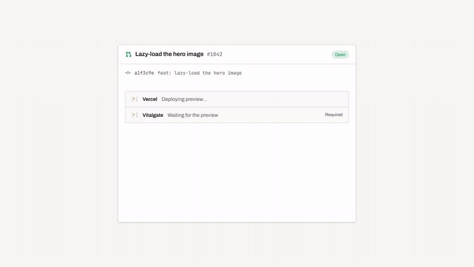
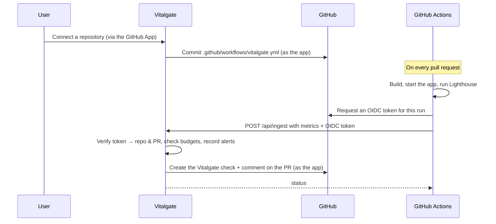

<div align="center">


# Vitalgate

**Performance budgets for every pull request.**

[](https://github.com/ingfranciscastillo/Vitalgate/actions/workflows/ci.yml)




[Overview](#overview) • [How it works](#how-it-works) • [Getting started](#getting-started) • [Configuration](#configuration) • [Development](#development) • [Deployment](#deployment)

</div>

## Overview

Vitalgate runs Lighthouse on every GitHub pull request, compares the results against the repository's performance budgets, and fails the PR check when a change breaks a required budget. Results are posted on the pull request, and alerts go out by email, Slack or Discord.

- **Budgets per repository** for LCP, CLS, FCP, TBT and the Lighthouse performance score, each one *required* (fails the check) or a *warning*.
- **Results on the pull request**: a *Vitalgate* check (make it required to block merges) and one comment per PR, updated on every push, with each metric, its change against the baseline and its budget.
- **Alerts** for budget violations, 3‑day regressions and a falling workspace score — by email, Slack or Discord — plus daily and weekly digests.
- **Workspaces** with owners, admins and view-only members, invitations, and per-workspace plans (Free: 1 repository; Pro: unlimited, Slack/Discord, extra rules, digests, more workspaces).
- **Least-privilege GitHub access** through a GitHub App installed only on the repositories you pick. Sign-in itself only reads your GitHub identity.

## How it works



Audits run on **your own** GitHub Actions runner: Vitalgate never builds or hosts your app. Each repository picks how in its Settings: **build** the app in the workflow and audit it on `localhost`, or audit the **preview deployment** a host such as Vercel, Netlify or Render reports to GitHub for the PR (no build, no secrets; Vitalgate finds the PR from the deployed commit). The workflow proves which repository and pull request it reports for with a short-lived token signed by GitHub (OIDC), so there is no secret to copy into each repository.

> [!NOTE]
> Lighthouse lab runs can't measure INP, which needs real user interactions. TBT is its lab stand-in, so budgets cover LCP, CLS, FCP, TBT and the performance score. Real-user INP, LCP and CLS for each repository's live site come from the [Chrome UX Report](https://developer.chrome.com/docs/crux) and show on the repository page.

## Getting started

### Prerequisites

- [Node.js](https://nodejs.org/) 22 or later and [pnpm](https://pnpm.io/) 12 (`corepack enable` picks the version pinned in `package.json`)
- A [Neon](https://neon.tech/) Postgres database (a dev branch is recommended)
- A GitHub account to create an OAuth app and a GitHub App
- Optional: [Resend](https://resend.com/) for email, Slack and Discord apps for alert delivery

### Install and run

```bash
pnpm install
cp .env.example .env.local   # then fill it in, see Configuration
pnpm db:push                 # create the schema in your database
pnpm dev                     # http://localhost:3000
```

Sign in with GitHub, install the GitHub App from **Connect a repository**, and pick a repository.

> [!IMPORTANT]
> GitHub Actions can't reach `localhost`, so the workflow's final *Report to Vitalgate* step only succeeds against a deployed instance (or a public tunnel set as `BETTER_AUTH_URL`).

## Configuration

Every variable is documented in [`.env.example`](.env.example). The main pieces:

| Variable | Purpose |
| --- | --- |
| `DATABASE_URL` | Neon connection string |
| `BETTER_AUTH_URL` | Public origin of the app; every absolute link and OAuth callback is built from it. Must be `https` in production. |
| `BETTER_AUTH_SECRET` | Signs sessions and OAuth state, encrypts stored GitHub tokens (`openssl rand -base64 32`) |
| `GITHUB_CLIENT_ID` / `GITHUB_CLIENT_SECRET` | GitHub OAuth app used for sign-in |
| `GITHUB_APP_ID` / `GITHUB_APP_SLUG` / `GITHUB_APP_PRIVATE_KEY` / `GITHUB_APP_WEBHOOK_SECRET` | The Vitalgate GitHub App |
| `RESEND_API_KEY` / `RESEND_FROM_EMAIL` / `CONTACT_EMAIL` | Alert, invitation and digest emails; contact form |
| `CRON_SECRET` | Bearer token Vercel Cron sends to the digest endpoints |
| `INTEGRATION_ENCRYPTION_KEY` | Encrypts Slack/Discord webhook URLs (32 bytes, base64) |
| `SLACK_*` / `DISCORD_*` | OAuth apps for Slack and Discord alerts |
| `CRUX_API_KEY` | Google Cloud API key for the Chrome UX Report API (real-user metrics). Free; without it the repository page explains how to turn them on. |

### GitHub OAuth app (sign-in)

Create it under **Settings → Developer settings → OAuth Apps** with the callback URL `$BETTER_AUTH_URL/api/auth/callback/github`. Sign-in requests only `read:user`, `user:email` and `read:org`.

### GitHub App (repository access)

Create it under **Settings → Developer settings → GitHub Apps**:

| Setting | Value |
| --- | --- |
| Setup URL | `$BETTER_AUTH_URL/api/github/setup`, with **Redirect on update** checked |
| Webhook URL | `$BETTER_AUTH_URL/api/github/webhook`, with a secret (`GITHUB_APP_WEBHOOK_SECRET`) |
| Repository permissions | Contents, Workflows, Pull requests, Checks: **Read and write**; Metadata: **Read-only** |
| Subscribe to events | **Repository** (installation events are always sent) |
| Logo | [`public/brand/github-app-icon.png`](public/brand/github-app-icon.png) |

Generate a private key and store it base64-encoded on one line:

```bash
base64 -w0 your-app.private-key.pem   # → GITHUB_APP_PRIVATE_KEY
```

> [!TIP]
> In development GitHub can't deliver webhooks to `localhost`. Create a channel at [smee.io](https://smee.io), use it as the app's webhook URL, and forward it:
>
> ```bash
> npx smee-client --url https://smee.io/<channel> --target http://localhost:3000/api/github/webhook
> ```

### Real-user metrics (Chrome UX Report)

In [Google Cloud Console](https://console.cloud.google.com/), enable the **Chrome UX Report API** for a project, create an API key under **APIs & Services → Credentials** (restrict it to that API), and set it as `CRUX_API_KEY`. Each repository's production URL is prefilled from its GitHub **Website** field and can be changed in its Settings. CrUX only covers public sites with enough Chrome traffic; answers are cached for a day per repository.

### Plans and billing (Polar)

A workspace's plan is the `plan` column of the `organization` table (`free` or `pro`). Pro is sold through [Polar](https://polar.sh) with the [Better Auth adapter](https://polar.sh/docs/integrate/sdk/adapters/better-auth): an owner or admin checks out from **Settings → Billing**, the workspace id travels as the checkout's `reference_id`, and Polar's subscription webhooks set the plan and fill `org_subscriptions`.

1. In Polar (start in the [sandbox](https://sandbox.polar.sh)), create a monthly **Pro** product and set `POLAR_PRO_PRODUCT_ID`; optionally a yearly one for `POLAR_PRO_YEARLY_PRODUCT_ID`, and a "forever" discount with a redemption limit for the founding price (`POLAR_FOUNDER_DISCOUNT_ID`).
2. Create an organization access token and set `POLAR_ACCESS_TOKEN` (and `POLAR_ENVIRONMENT=production` for live payments).
3. Add a webhook to `$BETTER_AUTH_URL/api/auth/polar/webhooks` with the `subscription.*` events, and set `POLAR_WEBHOOK_SECRET`.

Without these variables the Billing tab shows the plan only. To grant Pro by hand, update the column directly:

```sql
UPDATE organization SET plan = 'pro' WHERE slug = '<workspace-slug>';
```

## Development

| Command | Description |
| --- | --- |
| `pnpm dev` | Start the dev server on port 3000 |
| `pnpm build` / `pnpm preview` | Production build (Vercel preset) and local preview |
| `pnpm test` | Run the Vitest suite |
| `pnpm typecheck` | Type-check with `tsc` |
| `pnpm check` | Lint and format check with Biome |
| `pnpm db:push` | Apply the schema in `src/db` to the database |
| `pnpm db:generate` | Generate a SQL migration in `drizzle/` from schema changes |
| `pnpm db:studio` | Browse the database with Drizzle Studio |

CI ([`.github/workflows/ci.yml`](.github/workflows/ci.yml)) runs Biome, `tsc`, the tests and a production build on every push to `master` and every pull request.

### Project structure

```text
src/
├── routes/             # Pages (TanStack Router file routes)
│   ├── _authenticated/ # Dashboard, repositories, pull requests, alerts, team, settings
│   └── api/            # ingest, GitHub setup/webhook, auth, integrations, cron
├── lib/                # Server functions (*.functions.ts), server-only modules (*.server.ts), shared logic
├── components/         # UI components (shadcn/ui primitives in ui/)
└── db/                 # Drizzle schema (auth + product tables)
drizzle/                # SQL migrations
```

### Stack

[TanStack Start](https://tanstack.com/start) (React 19, Vite, Nitro) · [TanStack Router](https://tanstack.com/router) and [Query](https://tanstack.com/query) · [Drizzle ORM](https://orm.drizzle.team/) on [Neon](https://neon.tech/) Postgres · [Better Auth](https://www.better-auth.com/) · [Tailwind CSS](https://tailwindcss.com/) v4 and [Radix UI](https://www.radix-ui.com/) · [Resend](https://resend.com/) · [Biome](https://biomejs.dev/) · [Vitest](https://vitest.dev/)

## Deployment

Vitalgate is built for [Vercel](https://vercel.com/) (Nitro's `vercel` preset).

1. Create a production GitHub App and OAuth app pointing at your domain (a separate app from development).
2. Set every variable from `.env.example` in the Vercel project, with `BETTER_AUTH_URL` as your `https://` domain.
3. Apply the schema to the production database with `pnpm db:push`, using its `DATABASE_URL`.
4. Deploy. [`vercel.json`](vercel.json) registers the cron jobs — the daily digest (08:00 UTC) and the weekly digest (Mondays 09:00 UTC) — and the security headers.

> [!WARNING]
> Without a domain verified in Resend, email can only be delivered to the Resend account's own address. Verify a domain and set `RESEND_FROM_EMAIL` before inviting anyone.
